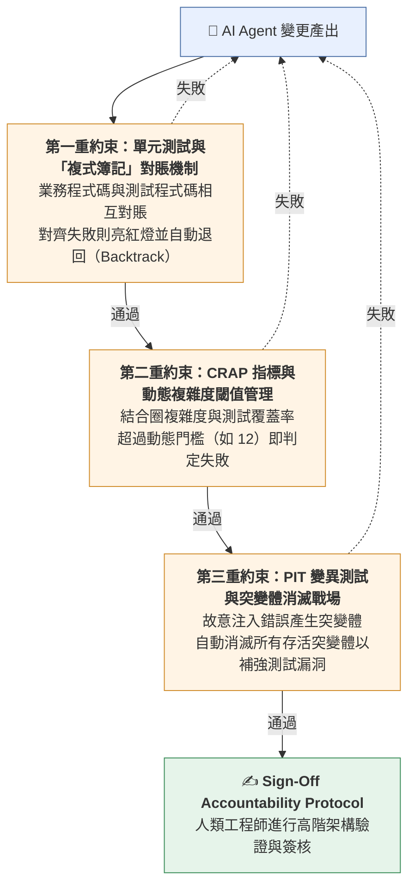
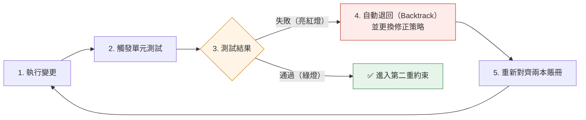
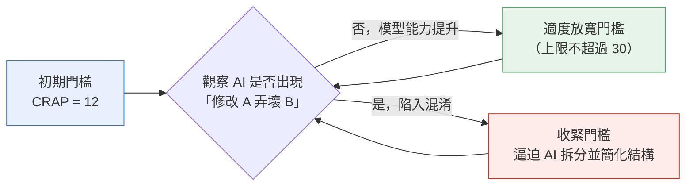
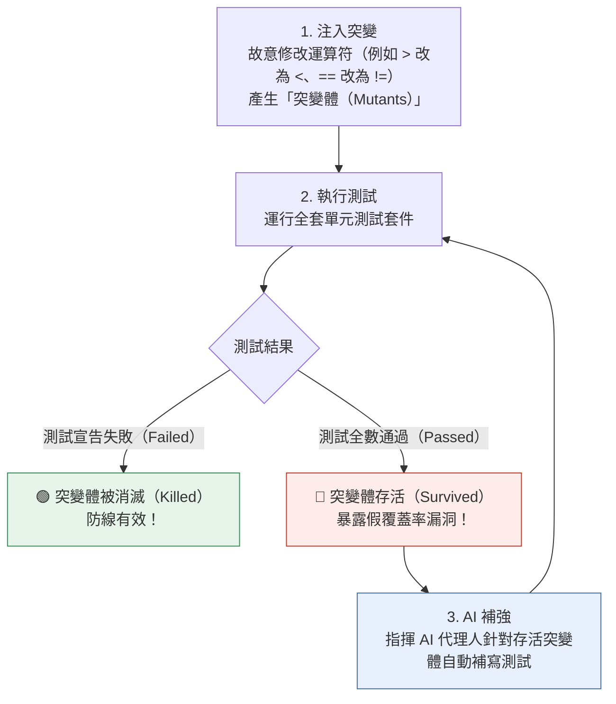
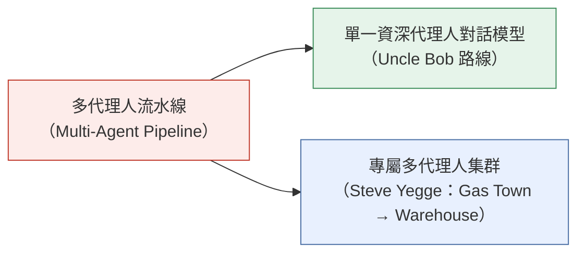
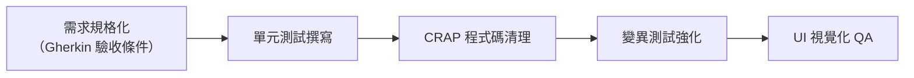
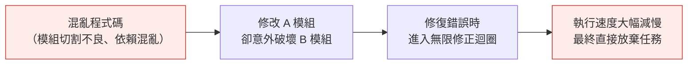
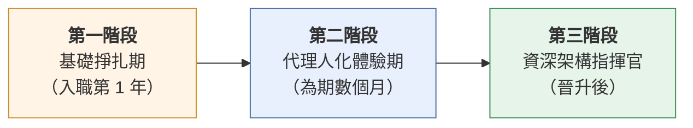

# 企業級 AI 代理人品質驗證與自動化防線架構指南

> 從程式碼審查到機器測量治理

**目錄**

1. [研發治理典範轉移：從人工程式碼審查到確定性機器約束](#1-研發治理典範轉移從人工程式碼審查到確定性機器約束)
2. [三重自動化品質約束機制](#2-三重自動化品質約束機制the-three-tiered-automated-quality-constraints)
3. [AI 代理人協同架構演進與 Clean Code 的策略價值](#3-ai-代理人協同架構演進與-clean-code-的策略價值)
4. [企業團隊落地與人才培力防線](#4-企業團隊落地與人才培力防線)

---

## 1. 研發治理典範轉移：從人工程式碼審查到確定性機器約束

### 1.1 人工逐行審查的瓶頸與 AI 代理人時代的治理困境

在生成式 AI 與自主 AI 代理人（AI Agents）技術快速演進的背景下，現代軟體開發的節奏已發生根本性的質變。AI 代理人不再僅是提供文字解答的聊天機器人，而是具備自主修改檔案系統、執行終端機指令、調用自動化工具，並根據執行反饋自我修正與調整策略的軟體實體。這種高程度的自主開發能力，使得程式碼產出的速度呈現指數級暴增。然而，傳統企業級研發治理高度仰賴「人工逐行程式碼審查（Line-by-line Code Review）」機制，要求資深架構師以肉眼閱讀並評估每一行產出的語法與邏輯。

這種產出速度與審查消化能力之間的巨大落差，使傳統人工審查迅速成為整體研發管線（DevOps Pipeline）中最嚴重的效率瓶頸。若企業強行將過去習慣的人類閱讀審查流程套用於 AI 代理人，其結果將是完全抵銷 AI 帶來的高速生產力。

為了解決此困境，許多團隊嘗試採用「提示詞約束（Text Prompts）」，例如向 AI 代理人提供長達 5 至 10 頁的團隊程式碼規範文件。然而，實務運作證明這種文字約束極具不確定性且幾乎無效：

- **規範被視為彈性建議**：AI 代理人往往將長篇的文字規範視為可有可無的「參考建議」（如同電影《神鬼奇航》中海盜守則般的彈性提示），缺乏硬性強制力。
- **脈絡中段規則忽略**：受限於 Context 處理特性與注意力機制，位於提示詞中段的詳細規則經常被 AI 忽略或遺漏。
- **缺乏確定性攔截機制**：單靠文字叮嚀無法在編譯或執行階段產生硬性攔截，無法防止不合規程式碼進入版本庫。

> 💡 真正的治理轉型，必須從「文字叮嚀」徹底轉向「**確定性機器工具檢查（Deterministic Machine Tool Checks）**」。

| 治理維度 | 傳統人工審查與提示詞防線 | 企業級機器測量自動化防線 |
|---|---|---|
| **審查速度** | 極慢（受限於人類閱讀與思考速度，需數小時至數天） | 極快（由確定性自動化工具於數秒至 30 分鐘內量化完成） |
| **規範執行力** | 低（提示詞易被忽略，人工審查易遺漏細節或標準不一） | 極高（確定性機器門檻，未達指標即自動硬性退回） |
| **可靠度與一致性** | 易受審查者疲勞、主觀偏好與個體經驗差異影響 | 數據指標客觀可衡量，跨團隊評估標準完全一致 |

### 1.2 責任歸屬屬性與人類工程師的最終簽署權（Sign-Off Accountability Protocol）

不論 AI 代理人的產出效率多高、產生的程式碼量有多龐大，「責任歸屬（Accountability）」依然是軟體架構與研發治理的核心命題。AI 代理人本質上是「極度不負責任（Irresponsible）」的實體；它無法為系統崩潰、資安漏洞或商業損失承擔任何法律、經濟或道義責任。因此，在可預見的未來數年內，唯有人類工程師能夠且必須為系統品質承擔最終責任。

這項事實逼迫人類工程師進行職責轉型：從「語法細節的字面閱讀者」升維為「高階架構的簽署者與承擔者」。例如 Linux 核心社群已在官方文件中明確規範：AI 代理人絕對不具備在補丁（Patch）上簽名的資格，提交變更的必須是人類，且該人類必須對 AI 產生的程式碼負起完全的最終責任。

目前業界技術領導者針對責任歸屬與審查模式，呈現出三種代表性的策略路線：

| 策略路線 | 代表人物 | 核心概念 | 適用情境 |
|---|---|---|---|
| **① 架構邊界與機器量化治理模式** | Robert "Uncle Bob" Martin | 工程師放棄逐行閱讀 95% 的程式碼語法，將注意力轉移至系統架構切割、模組依賴關係，以及三大機器約束指標的量化控制。 | 高度依賴自動化測試套件、擁有嚴格機器約束門檻，且追求極致開發速度的企業團隊。 |
| **② 補丁審查與嚴謹驗證模式** | Linux 核心維護者社群、Linus Torvalds | 堅持人類必須親自閱讀並審查補丁內容。雖然承認 AI 能提升生產力（如編譯器提升千倍效率、AI 提升十倍效率），但在關鍵核心系統上必須極度謹慎，不可盲目信任 AI。 | 作業系統核心、高安全性需求、底層基礎設施等一旦出錯會造成巨大災難的系統。 |
| **③ 完全可解釋性原則模式** | Simon Willison | 制定嚴格個人規範——若工程師無法向他人詳細解釋某段程式碼的內部運作邏輯與細節，就絕不允許將該程式碼納入專案中。 | 對程式碼掌握度有極高要求的個人開發者、核心架構組或高風險業務邏輯模組。 |

#### 業界現象悖論與「團隊現狀放大器」效應

Stack Overflow 2025 年開發者調查顯示，不信任 AI 準確度的比例（46%）已高於信任者；而 DORA 2025 年報告亦指出，雖然九成工程師在工作中使用 AI，但 AI 使用率越高，交付的穩定度反而可能越差。這種悖論（paradox）的根本原因在於：

> **AI 是一個「團隊現狀放大器（Team Status Amplifier）」。** 若團隊缺乏自動化機器約束防線，導入 AI 代理人只會以十倍的速度產生技術債與技術混亂，最終拉低整體交付穩定度。

> ⚠️ **架構治理觀點：商業與倡議者背景脈絡審視**
>
> 在評估業界領袖觀點時，企業研發主管必須保持客觀的商業脈絡審視：例如倡議「廢除人工 Code Review」的 Aviator 公司，其核心商業模式即為自動化驗證工具；而 Uncle Bob 個人亦提供 AI Agent 開發相關課程。儘管如此，其提出的機器量化治理原則在工程架構上具備極高的實務參考價值。

為了讓人類工程師在不逐行閱讀程式碼的前提下安心簽署並承擔責任，企業必須建立一套不可篡改且可自動量化的確定性品質閘門。

---

## 2. 三重自動化品質約束機制（The Three-Tiered Automated Quality Constraints）

### 2.1 第一重約束：單元測試與「複式簿記」對賬機制

單元測試（Unit Testing）是 AI 代理人開發流程中的第一道防線。其運作邏輯可借鑑會計學中的「複式簿記（Double-Entry Bookkeeping）」原理：

- **雙重記錄對賬**：會計上每一筆交易需同時記錄資金來源與資金去向，兩邊必須精確對齊；軟體開發中，業務程式碼記錄「功能做什麼（What standard does code follow）」，而測試程式碼則記錄「應得到什麼結果（What result is expected）」。
- **自動對賬與自我修正**：AI 代理人修改系統時，必須同時確保這「兩本賬冊」完全一致。當測試亮起紅燈，代表對賬失敗，系統即提供確定性的 Error Traceback。

在缺乏單元測試的情境下，AI 代理人極易在幾次迭代後走入發散且難以預測的幻覺與異常狀態。而在複式簿記機制下，當 AI 代理人發現自己弄壞了測試，它能根據失敗訊息自動退回（Backtrack）並更換修復方向：

### 2.2 第二重約束：CRAP 風險指標與動態複雜度閾值管理

僅依靠單元測試無法保證程式碼結構的健康度。第二重約束引入 CRAP（Change Risk Anti-Patterns）指標，作為衡量程式碼維護風險與結構複雜度的量化標準。

CRAP 指標結合了「圈複雜度（Cyclomatic Complexity，即程式碼內部的分叉路徑數）」與「測試覆蓋率（Test Coverage）」。其計算哲學為：**分叉路徑越多且測試覆蓋率越低，風險分數呈現暴漲趨勢**。

$$
\text{CRAP}(m) = C^2 (1 - p)^3 + C
$$

其中 $C$ 為圈複雜度，$p$ 為測試覆蓋率比例。

| 圈複雜度 | 測試覆蓋率 | CRAP 風險分數 | 評估與管理門檻基準 |
|---|---|---|---|
| 10 條分叉路徑 | 0%（完全無測試） | **110.0** | 🔴 **極高風險**（遠超傳統危險閾值 30，不可接受） |
| 10 條分叉路徑 | 50% | **22.5** | 🟡 **中度風險**（傳統人類開發可接受上限） |
| 10 條分叉路徑 | 100% | **10.0** | 🟢 **低風險**（充分測試） |
| — | — | **> 30** | **傳統危險閾值**（原作者 Alberto Savoia & Bob Evans 定義之界線） |
| — | — | **12** | **AI 代理人初期嚴格門檻**（Uncle Bob 初期採用的嚴格標準） |

#### 動態風險閾值管理（Dynamic Risk Thresholding）：人類 vs. AI 代理人

- **人類的認知極限**：人類的大腦短期記憶（Short-term Memory）僅能同時處理 5 至 7 個項目。當一個函式包含過多判斷分叉（圈複雜度過高）時，人類工程師讀到後面就會遺忘前面，因此過去極度強調函式必須極小化。
- **AI 代理人的混淆閾值（Confusion Threshold）**：AI 代理人具備大容量 Context 記憶能力，能同時處理數十個變數與邏輯分支，因此傳統針對人腦設計的極端小函式門檻，對 AI 而言可適度放寬。
- **動態管理實務**：企業應觀察 AI 代理人的「混淆閾值」——即 AI 在修改 A 處程式碼時開始頻繁弄壞 B 處程式碼的臨界點。初期可將 CRAP 門檻設定於嚴格的 12，隨著代理人模型能力提升，動態調整該門檻；一旦代理人開始陷入混淆圈套，即重新收緊 CRAP 門檻，逼迫代理人自動拆分並簡化程式碼結構。

### 2.3 第三重約束：PIT 變異測試與突變體消滅戰場

傳統的「測試覆蓋率」存在重大漏洞：**覆蓋率僅代表程式碼被執行過，不代表其邏輯正確性被嚴謹驗證過**。為解決此問題，第三重約束引入 PIT 等變異測試（Mutation Testing）工具，作為品質驗證的終極防線。

> 📜 **變異測試的歷史範式轉變**
>
> 在 2000 年前後，Uncle Bob 等技術先驅便曾嘗試導入變異測試。然而在當時，全系統執行一次變異測試需要耗費整整一晚，且產出的存活突變體需要工程師逐一耗費體力手工修復，極不具備經濟實務性，因而被長期擱置。
>
> 如今，AI 代理人具備「速度極快且不知疲倦」的特質。AI 代理人可以在約 30 分鐘內執行完 PIT 變異測試，並自動根據報告補強測試套件，消滅所有存活的突變體，使過去昂貴的驗證技術在 AI 時代獲得新生。

**PIT 變異測試與自動消滅閉環**

循環持續進行，直至突變體全數消滅。

這三重機器約束構建出一座堅固且客觀的品質柵欄；在此自動化防線之上，企業與工程師方能重新調配與 AI 代理人的協同分工模式。

---

## 3. AI 代理人協同架構演進與 Clean Code 的策略價值

### 3.1 協同模式轉型：從多代理人流水線（Pipeline）到高階工程師對話模型

在探討 AI 代理人的協同架構時，業界經歷了從「多代理人流水線（Multi-Agent Pipeline）」向「單一資深代理人對話模型」與「專屬多代理人系統」的平行演進。

#### 多代理人流水線模式的陷阱與覺醒

團隊初期常嘗試將開發流程拆分為多個專職代理人：

雖然此模式看似分工嚴密，但在實務上卻面臨巨大痛點：

1. **龐大的交接成本與資訊洩露（Context Leakage）**：代理人之間的 context 傳遞極易失真或洩露，為防止洩露需編寫大量複雜的隔離邏輯。
2. **極低的執行效率**：一個人類手動執行僅需 5 分鐘的簡單任務，進入多代理人流水線運作後，可能需要耗費長達 1 小時的跨代理人交接與處理。

Uncle Bob 在實踐中產生了兩大關鍵覺醒：

- **自我工具矛盾**：他意識到自己在建構該套流水線的整個過程中，**從未曾使用流水線來開發該流水線本身**，自始至終都是直接指揮單一代理人。
- **高階對話辯論力**：在一場與 Grok 長達 45 分鐘的深度對話中，AI 代理人針對其提出的架構方案主動提出了具備充分邏輯的反駁與替代提案。這讓他意識到，強大的 AI 代理人應被視為「資深同儕審查者（Senior Peer Reviewer）」，而非工廠流水線上僅能執行單一雜事的不思考工人。

#### 對立實踐：Steve Yegge 的 *Gas Town* 至 *Warehouse* 演進

與 Uncle Bob 回歸單一資深代理人不同，Steve Yegge 的實踐展現了另一種企業級視角。其開源的多代理人工廠系統 *Gas Town*（於 2026 年初開源）在經歷資源消耗與架構瓶頸後燒毀，但 Yegge 並未放棄多代理人，而是轉向開發 *Warehouse* 系統——一個同時指揮 50 至 60 個針對特定專案領域量身打造（Bespoke）的代理人集群。

> **Yegge 的核心結論**：開箱即用的通用多代理人流水線框架必定失敗；但針對特定業務專案深度客製的專屬多代理人架構（Bespoke Multi-Agent Architecture）則能展現強大威力。

| 評估維度 | 多代理人流水線模式 (Multi-Agent Pipeline) | 資深代理人對話模式 (Senior Agent Dialogue) | 專屬多代理人集群 (Bespoke Warehouse Model) |
|---|---|---|---|
| **執行效率** | 較低（單一任務耗時約 1 小時） | 極高（即時深度研討與工具調用） | 中至高（需大量平行運算資源） |
| **維護複雜度** | 極高（需處理通用 Context 洩露） | 低（聚焦於單一上下文深度） | 高（需量身打造專案級 Agent 邊界） |
| **互動模式** | 單向流水線傳遞（工廠工人） | 雙向研討（具備反駁與提案能力） | 矩陣式分工（領域專精 Agent 協同） |
| **適用情境** | 高度標準化且無架構決策之任務 | 複雜業務邏輯與核心架構設計 | 大型企業複雜多模組專案 |

### 3.2 Clean Code 在 AI 時代的策略價值與機器自動化逼近

市場上存在一種流行迷思，認為「既然程式碼大部分由 AI 撰寫，Clean Code（潔淨程式碼）就不再重要」。實務經驗完全否定了這種觀點。

**混亂程式碼（Messy Code）對 AI 代理人的破壞力，與對人類工程師無異。** 當 AI 代理人面對一套模組切割不良、依賴關係混亂的系統時，它會迅速陷入以下困境：

因此，Clean Code 的核心價值——**良好的模組分割、明確的依賴管理、清晰的命名與職責分離**——在 AI 時代不僅依然有效，反而成為 AI 代理人能否高效運作的決定性前提。

**Clean Code 在 AI 代理人時代的繼承與調整矩陣**

| ✅ 永遠保留的核心價值 | 🔧 針對 AI 放寬與調整的開發紀律 |
|---|---|
| 嚴謹的模組切割與架構邊界 | 放寬嚴格的 TDD（測試驅動開發）順序 （接受 AI「先寫函式再補測試」的習慣） |
| 正確且清晰的依賴關係管理 | 動態調整圈複雜度與 CRAP 門檻 |
| 明確的業務邏輯命名與職責分離 | 規避長篇文字叮嚀，改採機器工具攔截 |
| 高度可測性與可驗證性設計 | |

企業必須理解，開發紀律的執行方式已改變：我們不再強制要求 AI 遵循針對人腦設計的 TDD（測試驅動開發）微觀順序（先寫一小段測試、再寫一小段程式碼），而是接受 AI 代理人「先完成函式、再補充測試」的習慣，並**透過三重機器自動化門檻嚴格把關最終結果**。

建構了自動化驗證機制與協同模式後，企業研發團隊必須妥善規劃組織內部的人才培訓與實務落地防線。

---

## 4. 企業團隊落地與人才培力防線

### 4.1 新進工程師（Junior Developers）的「代理人模擬培力協定」（Junior Developer Agent-Simulation Protocol）

隨著 AI 代理人承接了大量基礎程式碼撰寫工作，企業面臨一個嚴峻的隱憂：**新進工程師若缺乏親手編寫程式碼與「掙扎經驗（Struggle Experience）」，將產生嚴重的判斷力斷層（Judgement Gap）**。

#### 掙扎經驗（Struggle Experience）的心理學與架構價值

資深工程師之所以能在一秒內識別出 AI 代理人正在陷入邏輯迴圈、產生幻覺或寫出壞味道程式碼，**完全是因為他們過去曾經親自在這些錯誤中掙扎過**。未曾親手體驗過除錯痛楚的新人，絕對無法建立對程式碼結構健康的直覺感應。

為了確保企業技術梯隊不出現斷層，企業應將新人培訓納入「代理人模擬培力協定（Junior Developer Agent-Simulation Protocol）」：

| 職涯演進階段 | 訓練重點 | 約束與治理工具 | 目標建立能力 |
|---|---|---|---|
| **第一階段：基礎掙扎期** （入職第 1 年） | 100% 手動編寫程式碼，包含週末組合語言（Assembly）等底層機制實作練習。 | 傳統編譯器、基本 Linter 與人工 Code Review。 | 理解機器底層運作邏輯，建立對程式碼結構與錯誤的「直覺感應」。 |
| **第二階段：代理人化體驗期** （為期數個月） | 模擬 AI 代理人的角色，接收相同粒度的任務，並**完全接受與 AI 相同的確定性機器工具約束**。 | 第一重：單元測試對賬 第二重：CRAP 指標限制 第三重：PIT 變異測試 | 體驗極度嚴格的機器量化治理，學習如何在機器約束下寫出高品質程式碼。 |
| **第三階段：資深架構指揮官** （晉升後） | 停止逐行編寫程式碼，全面轉向指揮 AI 代理人，進行高階對話與視覺化架構監督。 | 視覺化架構圖、終端機代理人控制台、三重機器約束儀表板。 | 具備高階架構切割、邊界判定與 Sign-Off Accountability Protocol 承擔能力。 |

### 4.2 企業 AI 品質防線建立清單與架構總結

企業研發領導者在推進 AI 代理人落地時，應抱持敏捷與動態調整的心態（認知到 AI 工具與最佳實踐每月都在劇烈變革），並秉持以下核心治理哲學：

> 🎯 **「不看程式碼，但精確測量程式碼」**

以下為企業技術領導者可立即執行的落地檢查清單：

#### 企業 AI 品質防線建置執行清單（Actionable Checklist）

**1. 部署確定性機器品質閘門（Deterministic Quality Gateways）**

- [ ] 廢除超過 5 頁以上的文字提示詞規範，將團隊標準轉化為 CI/CD 可執行之自動化檢查腳本。
- [ ] 配置 CI 管線，確保 AI 代理人提交的任何變更均強制觸發確定性工具攔截。

**2. 部署第一重約束：單元測試與「複式簿記」對賬機制**

- [ ] 強制要求所有業務模組配對相應的單元測試，達成雙重記錄對賬。
- [ ] 配置 AI 代理人執行環境，使其在測試亮紅燈時能自動獲取 Error Traceback 並進行回溯（Backtrack）修正。

**3. 部署第二重約束：CRAP 風險指標與動態風險閾值管理（Dynamic Risk Thresholding）**

- [ ] 在 CI 管線中整合 CRAP 計算工具（結合圈複雜度與測試覆蓋率）。
- [ ] 針對 AI 代理人設定初始 CRAP 門檻（建議初始值設為 12，上限絕不超過 30）。
- [ ] 建立動態監控機制：當 AI 代理人出現「修改 A 弄壞 B」的混淆現象時，自動觸發 CRAP 門檻收緊。

**4. 部署第三重約束：PIT 變異測試與突變體自動消滅**

- [ ] 在 CI/CD 管線中整合 PIT 等變異測試工具。
- [ ] 設定自動化指令，要求 AI 代理人自動解析「存活突變體（Survived Mutants）」報告，並補充單元測試直至突變體全數消滅。

**5. 落實人類工程師簽署協定（Sign-Off Accountability Protocol）**

- [ ] 停止要求資深工程師對 AI 產出的程式碼進行逐行肉眼審查。
- [ ] 提供工程師視覺化架構圖工具，將審查重點轉移至模組切割、依賴方向與三大機器指標數據。
- [ ] 明確簽署責任：正式實施人類簽署協定，確保每個上線的 AI 變更均由指定人類工程師承擔完整業務與法律責任。

**6. 實施新進工程師「代理人模擬培力協定」**

- [ ] 為新進工程師制定第一年底層實作（含組合語言練習）與「代理人化體驗期」訓練計劃，弭平判斷力斷層。
